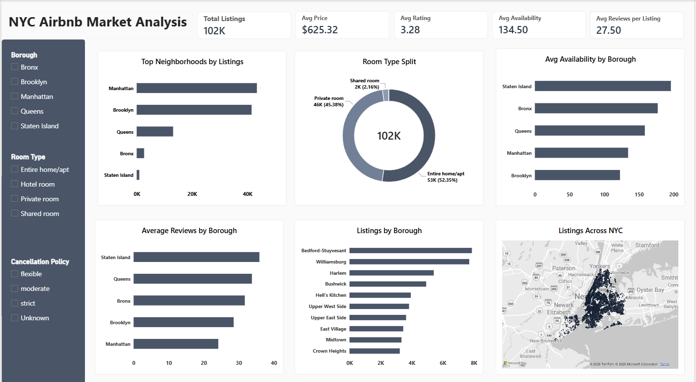

NYC Airbnb Listings Analytics Dashboard

An analysis of about 101,700 New York City Airbnb listings covering supply, availability and guest reviews, built with Python, MySQL and Power BI.

# Business Question
Where is Airbnb supply concentrated in NYC, and which boroughs and room types have the most unused availability?

# Dashboard

# Key Findings
- Manhattan (43.4K) and Brooklyn (41.5K) hold over 83% of all listings.** Queens, the Bronx and Staten Island share the rest.
- Entire homes (52%) and private rooms (45%)** make up almost the whole market. Shared and hotel rooms are about 2%.
- Staten Island listings are open the most, about 196 days a year**, against 123 days in Brooklyn and 134 in Manhattan.
- Staten Island also has the most reviews per listing (about 36)**, while Manhattan has the fewest (about 24).
- The average review rating is 3.28 out of 5, and the average listing has about 27 reviews.

# Data Cleaning (Python)
The raw file had 102,599 rows and 26 columns. After cleaning, 101,735 rows and 22 columns remain.
- Removed 541 duplicate listings and rows with a missing price.
- Converted `price` and `service fee` from text with `$` signs into numbers.
- Dropped `license` and `house_rules` (mostly empty) and `country` and `country code` (the same value in every row).
- Fixed misspelled borough names (for example "brookln" and "manhatan").
- Set impossible values in `availability_365` (negative or above 365) and `minimum_nights` to missing.
- Filled missing category values (`cancellation_policy`, `instant_bookable`, `host_identity_verified`, `host_name`) with "Unknown".
- Standardized column names to lowercase with underscores.

# SQL Analysis (MySQL)
15 queries covering `GROUP BY` and `HAVING`, subqueries, `CASE`, `ROW_NUMBER()` and window functions over aggregates. They answer questions such as listings per borough, average rating by room type, price categories per borough, estimated occupancy, and each room type's share of its borough.

# Power BI Dashboard
A one-page dashboard with 5 KPI cards, 3 slicers (borough, room type, cancellation policy), a map of listings, and charts for listings by borough, room type split, average availability by borough, average reviews by borough, and the top 10 neighbourhoods.

# Project Files
- `airbnb_clean.csv`: cleaned dataset
- `data_cleaning.ipynb`: Python cleaning notebook
- `airbnb_queries.sql`: all 15 SQL queries
- `Airbnb_Dashboard.pbix`: Power BI file
- `Dashboard.png`: dashboard screenshot

## Notes and Limitations
- In this dataset, price shows almost no variation by borough, room type, cancellation policy or review rating (average about $625 everywhere). That is unusual for real Airbnb data, so the analysis focuses on supply, availability and reviews, not price drivers.
- The file has no booking counts, so reviews are a rough indicator of demand, and the occupancy figure in the SQL queries is estimated from availability, not actual bookings.
- `host_id` is almost unique per listing, so host-level analysis isn't reliable. Query 14 counts host names, and a common name can be many different hosts.
- The dataset doesn't state a currency, so prices are shown without a symbol.
- Dataset source: Kaggle, "Airbnb Open Data".